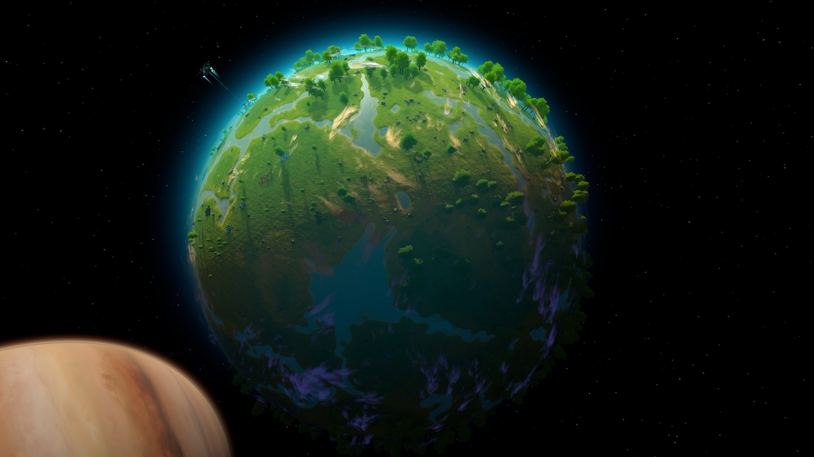
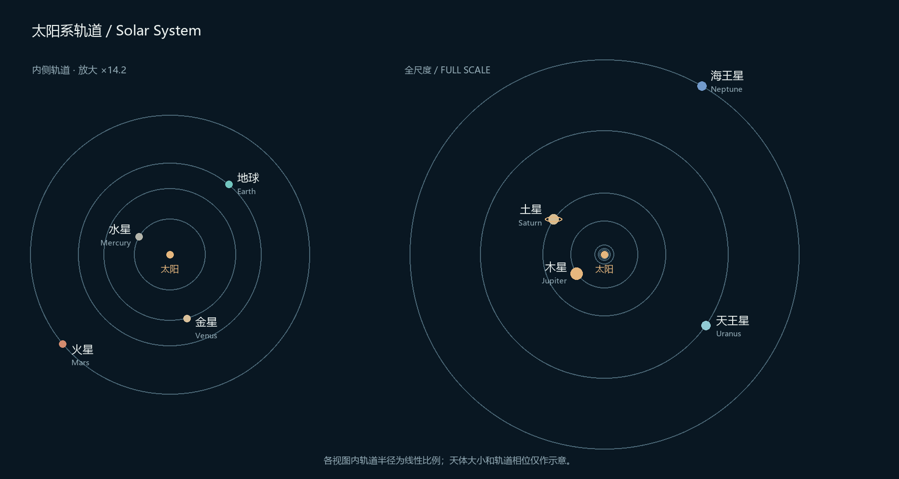
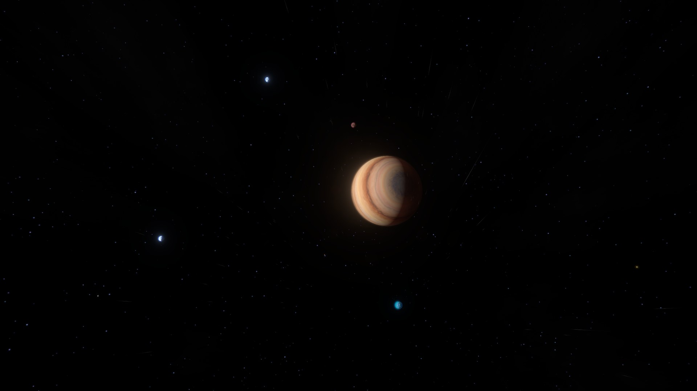

# BetterSolarSystem

[简体中文](README.zh-CN.md) · 3.3.0 preview · Requires Galactic Scale

[Download 3.3.0](https://github.com/cmx00/BetterSolarSystem/releases/tag/v3.3.0)

BetterSolarSystem is a Dyson Sphere Program mod built on Galactic Scale (GS2). It reworks the Solar System start, preserving the eight major planets' real orbital-distance ratios and giving the planets more space.

You begin on Europa, with basic resources nearby and rare resources to mine on other worlds. Radius-200 worlds remain common for familiar blueprints, alongside larger construction worlds, small mining bodies and much larger gas giants.



## Solar System layout

Closely packed worlds of similar sizes make a Solar System look crowded. This layout changes the GS2-generated system: the inner rocky planets remain relatively close, the outer giants are farther apart, and gas giants are visibly larger than their moons.

The major planets retain the real Solar System's orbital-distance ratios. Body sizes, solar output and some environments are adjusted for gameplay.



*Orbital distances use a linear scale. The inner four planets are enlarged separately on the left for readability; body markers and orbital phases are illustrative.*

The starting system contains the Sun and 23 planets and moons: the eight major planets, Ceres, Pluto and thirteen satellites. Your home is a radius-300 prairie Europa. Unlike the real moon, this Europa is habitable so you can start a factory there.

## Planet sizes and blueprints

Different planet radii produce different building grids. Vanilla blueprints may not fit larger planets, so the galaxy retains plenty of radius-200 worlds for factories.

| Radius | Role |
| --- | --- |
| 200 | The familiar vanilla building scale, suitable for factories and blueprints made for that radius |
| 300 | More construction space, including the starting moon |
| 50 | Small mining outposts that supply larger bases |

Solid worlds use only these three radii. Most ordinary moons have radius 200, with fewer radius-50 moons; the starting moon is the only radius-300 satellite. The four gas and ice giants use much larger scales. Blueprints still encounter grid differences between radii; universal cross-radius compatibility is not provided.

## Starting resources

The starting world has enough iron, copper and other basic resources for an early factory. Deposits form tighter mining groups, and larger planets receive more clusters. Oil has its own flow limits to prevent excessively productive individual wells.

Extra resources are spread across Europa and other Jovian moons. The Solar System includes fractal silicon, and small bodies such as Charon have rare deposits. Later production requires interplanetary transport.

Starting deposits are spread across more directions to reduce concentration on one hemisphere.

New galaxies keep limited silicon, titanium and organic-crystal samples on Europa. Ganymede supplies fire ice and optical grating crystals; Callisto supplies silicon, titanium and fractal silicon. Earth retains biological rare resources for later extraction. Existing deposits are not redistributed.

## Balance presets

Choose a preset in the configuration file, then restart:

| Preset | Behavior |
| --- | --- |
| Recommended | Fresh-install default: 1.5× ground range, 4× space range, 1.25× signal coverage and 110m battlefield-base ranges; travel and sail adjustments below |
| GalaxyOnly | Galaxy generation only; defense, Dark Fog travel and sail balance patches are not installed |
| EnhancedDefense | 1.5× ground range, 4× space range, 2× signal coverage and 110m base ranges; recommended travel and sail settings |
| Custom | Uses individual settings. Existing configurations select this preset and retain their values |

Recommended and EnhancedDefense do not register global ground targets. Custom has separate ground, space and signal controls. Presets do not overwrite those settings.

## Dark Fog and defenses

Wider orbits mean longer journeys for Dark Fog fleets and supply ships. At the original speeds, attacks and resupply would spend too much time in transit, so travel speeds and delivery capacities are increased.

Attack range and target-search range are separate. This mod adjusts both so a tower can find enemies within its extended firing range. Attack layers, pitch and obstruction checks remain in place, and signal towers still need to be built normally.

Solar sails also last longer, reducing the number you need to keep launching to maintain power output.

| Default adjustment | Effect |
| --- | --- |
| Dark Fog fleet and supply-ship travel speed ×2 | Shorter travel and resupply delays |
| Supply-ship matter and energy capacity ×2 | More supplies per delivery |
| Newly launched solar-sail lifetime ×4 | Less ongoing replacement to maintain sail power |

Multipliers apply to the game's runtime baseline and may stack with other mods changing the same systems. Already launched sails keep their existing expiry times.



For extended ground ranges, gauss and local-plasma projectile lifetimes track the effective range. Extended straight shots check planet curvature, terrain and vegetation. Missile guidance, cannon trajectories and collision rules remain intact.

## Other star systems

Primary planet counts range from one to eight, with possible moons and a small outer body. Layouts include compact rocky systems, hot Jupiters, ocean worlds and outer giants.

Some systems have only a few worlds; others have several planets and moons. Each retains mineable, buildable worlds.

## Installation

Requires **BepInEx and Galactic Scale**. Install the dependencies with a mod manager, then install the package from the release linked above. GS2 supplies the galaxy-generation interface.

For a new game, select the **Galactic Scale 2** generator. The Sol and Dev generators do not apply this mod's layout.

For manual installation, close the game and place both files at:

```text
BepInEx/plugins/BetterSolarSystem/BetterSolarSystem.dll
BepInEx/patchers/BetterSolarSystem/BetterSolarSystem.Compat.dll
```

Disable older GS2Tweaks, Global Signal Tower and GS2GameCompat installations to avoid duplicate modifications. Settings are in `BepInEx/config/cmx.BetterSolarSystem.cfg`.

## Saves

**The complete layout requires a new galaxy.** Existing saves retain their orbits, radii and deposits. Runtime name fixes and balance changes can apply, and custom names are preserved. Back up saves and their companion files before changing mods.

## Parameters and compatibility

Normal solid-resource clusters contain 16–24 mining nodes; small bodies use 12–16. Radius-300 worlds receive twice as many clusters of each solid resource, without doubling individual oil-well flow. The oil target is 1.5–6/s before research bonuses.

They Come From Void keeps its own invasion sequence. This mod changes travel and defense settings, not its wave progression.

See [BUILDING.md](BUILDING.md) to build from source. Reports should include game and GS2 versions, generator, seed and screenshots. Source is under the [MIT License](LICENSE); code provenance and image rights are described in [NOTICE.md](NOTICE.md).
